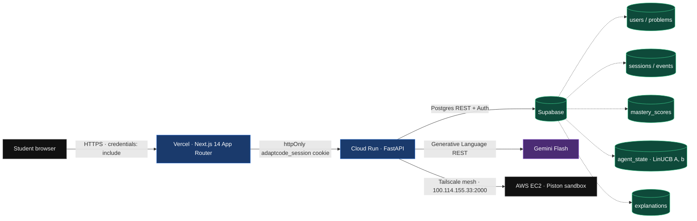

<div align="center">


### An adaptive DS&A tutor that *learns you* while you learn to code.

**Bayesian Knowledge Tracing models your mastery. A contextual bandit picks your next problem. A real sandbox grades your code. Gemini explains what broke.**

&nbsp;

[**→ Live app**](https://adapt-code.vercel.app) &nbsp;·&nbsp; [**→ Backend health**](https://adaptcode-backend-c4evyt3utq-as.a.run.app/health) &nbsp;·&nbsp; [**→ Architecture**](docs/ARCHITECTURE.md) &nbsp;·&nbsp; [**→ API**](docs/API.md)

&nbsp;


</div>

---

## Table of contents

- [What AdaptCode is](#what-adaptcode-is)
- [How it feels, in one loop](#how-it-feels-in-one-loop)
- [System architecture](#system-architecture)
- [The adaptive loop, deeply](#the-adaptive-loop-deeply)
- [The math (BKT + LinUCB)](#the-math-bkt--linucb)
- [Project layout](#project-layout)
- [Database schema](#database-schema)
- [Routes](#routes)
- [Running it locally](#running-it-locally)
- [Configuration](#configuration)
- [Deployment](#deployment)
- [Security model](#security-model)
- [Testing](#testing)
- [Tech stack (end to end)](#tech-stack-end-to-end)
- [Roadmap](#roadmap)
- [License](#license)

---

## What AdaptCode is

AdaptCode is a personalised DS&A practice platform. Most sites give every student the same next problem. AdaptCode doesn't.

Under the hood it runs two models that update on every submission:

| Model | Job | Lives in |
|---|---|---|
| **Bayesian Knowledge Tracing (BKT)** | Estimates the probability you *actually* know each concept, separately from guessing + slipping. | `backend/app/services/bkt.py` |
| **LinUCB contextual bandit** | Looks at how you've been doing (streak, error rate, time on task, current mastery) and picks a *pedagogical action* — easier, same, harder, redirect to a prerequisite, or hint. | `backend/app/services/linucb.py` |

On top of that:

- **Real sandboxed execution** — your code runs in Piston on an AWS EC2 node, reached only over a private Tailscale mesh. Not a public port.
- **LLM post-mortems** — when you fail, Gemini Flash reads your code + the failing test and writes a 3-part explanation (`what_went_wrong`, `why_approach_fails`, `concept_to_review`).
- **~473 real problems** across 12 concepts, seeded from a curated LeetCode-derived corpus with hidden test cases.

### Live stack

| Piece | Where it lives |
|---|---|
| Frontend | **Vercel** · [adapt-code.vercel.app](https://adapt-code.vercel.app) |
| Backend  | **Google Cloud Run** (`asia-southeast1`) · [adaptcode-backend-…run.app](https://adaptcode-backend-c4evyt3utq-as.a.run.app/health) |
| Sandbox  | **AWS EC2** (Piston via Tailscale userspace sidecar) |
| DB + Auth | **Supabase** (Postgres 15 + hybrid email/password + Google OAuth) |
| LLM | **Google Gemini Flash** (`gemini-flash-latest` alias) |

---

## How it feels, in one loop

```text
  you sign up  ──►  diagnostic picks a starter problem
       │
       ▼
  ┌────────────────────────────────────────────────┐
  │   Monaco editor · hidden test cases · Submit   │
  └────────────────────────────────────────────────┘
       │
       ▼
   Piston runs your code → verdict + per-test diff
       │
       ├─► BKT updates mastery P(known | observed)
       ├─► session_events logged (timing, errors, hints)
       ├─► LinUCB picks next pedagogical action
       └─► if failed → Gemini drafts a 3-part explanation (async)
       │
       ▼
  next problem appears · mastery bar moves · graph lights up
```

Everything on the right happens in one `/api/submit` call. The frontend never has to orchestrate — the backend is the brain.

---

## System architecture



**Why this shape:**

- Vercel for the frontend → free, fast edge, instant previews on every push to `main`.
- Cloud Run for the backend → scales to zero, pay-per-request, custom Dockerfile keeps the Tailscale sidecar.
- Piston on EC2, **never on a public port** → the sandbox is only reachable at a Tailscale IP. The attack surface is a private mesh, not the internet.
- Supabase does the two things it's actually best at: Postgres + auth.
- BKT + LinUCB live in-process in FastAPI; their state (mastery scores, personalised bandit matrices) persists to Postgres.

Full topology in [docs/ARCHITECTURE.md](docs/ARCHITECTURE.md).

---

## The adaptive loop, deeply

Every `POST /api/submit` runs this 5-phase pipeline in `backend/app/routers/problems.py`:

### Phase 1 — Evaluation
1. Receive `{ problem_id, code, language }`.
2. Fetch the problem's hidden test cases from `problems`.
3. POST code + tests to Piston over Tailscale.
4. Compare stdout to expected output per test case.
5. Produce a verdict: `Accepted` / `Wrong Answer` / `Runtime Error` / `Compilation Error` / `TLE`.

### Phase 2 — BKT mastery update
1. Load the student's prior `P(known)` for this concept from `mastery_scores`.
2. Apply graded behavioural penalties ρ: hint used → smaller signal, many attempts → smaller signal, raw compile errors → smaller signal.
3. Compute posterior `P(known | observed)` and persist.

### Phase 3 — Telemetry
Insert a row in `session_events` with timings, hints used, compile errors, final verdict. This is the dataset the bandit learns from.

### Phase 4 — LinUCB bandit picks next action
1. Load this student's personal `A` (d×d) and `b` (d) matrices from `agent_state` (serialised JSON).
2. Build a d=16 context vector `x`: recent accuracy, streak, avg time, mastery gap, difficulty, concept flags.
3. Compute UCB score for each of the 5 actions:
   - `0 easier`
   - `1 same`
   - `2 harder`
   - `3 redirect_prerequisite`
   - `4 hint_augmented`
4. Pick the action with the highest UCB; the backend then queries `problems` for an unsolved one matching that target.
5. Observe reward from the *previous* step and rank-1 update `A` and `b`. Persist.

### Phase 5 — LLM post-mortem (background task)
If the verdict is not `Accepted`, a FastAPI background task calls Gemini with the student's code + the first failing test case and asks for structured JSON:

```json
{
  "what_went_wrong": "…",
  "why_approach_fails": "…",
  "concept_to_review": "…"
}
```

The frontend polls `/api/explanation/{event_id}` to pick it up when ready — so the user sees the verdict instantly and the explanation streams in a beat later.

---

## The math (BKT + LinUCB)

### Bayesian Knowledge Tracing

Classic BKT has four parameters per concept:

- `pL0` — prior probability of knowing the concept
- `pT`  — probability of transitioning from unknown → known on a practice
- `pG`  — probability of guessing correctly without knowing it
- `pS`  — probability of slipping (knowing it but getting it wrong)

Update on a correct answer:

$$P(L_n | \text{correct}) = \frac{P(L_{n-1})(1 - p_S)}{P(L_{n-1})(1 - p_S) + (1 - P(L_{n-1})) p_G}$$

Then apply the learning transition: `P(L_n) = P(L_n | obs) + (1 - P(L_n | obs)) · pT`.

AdaptCode adds a behavioural weight ρ ∈ [0, 1] — a submission with 3 hints used counts less than a clean solve. See `backend/app/services/bkt.py`.

### LinUCB contextual bandit

For each action `a` with per-student matrices `A_a` (d×d, starts as I) and `b_a` (d), given context `x` (d-vector):

$$\hat{\theta}_a = A_a^{-1} b_a \qquad \text{UCB}_a = \hat{\theta}_a^{\top} x + \alpha \sqrt{x^{\top} A_a^{-1} x}$$

Pick `argmax_a UCB_a`. After observing reward `r`, update:

$$A_a \leftarrow A_a + x x^{\top} \qquad b_a \leftarrow b_a + r \cdot x$$

Default `d = 16`, `α = 1.0`. Matrices persist as nested JSON in `agent_state.a_matrices` / `agent_state.b_vectors`. See `backend/app/services/linucb.py`.

---

## Project layout

```
Adapt_Code/
├── frontend/                   # Next.js 14 App Router
│   └── src/app/
│       ├── (app)/              # Authenticated shell
│       │   └── problem/[id]/   # Monaco editor + submit + explanation poll
│       ├── mastery/            # Concept-level mastery bars
│       ├── graph/              # Prerequisite / concept graph viz
│       ├── login/              # Hybrid email + Google OAuth
│       ├── onboarding/         # Diagnostic flow
│       ├── profile/[user]/     # Public-ish profile (real data)
│       ├── settings/           # Display name, theme, danger zone
│       ├── error.tsx           # Root error boundary
│       ├── loading.tsx         # Route transition shell
│       └── not-found.tsx       # Branded 404
│
├── backend/                    # FastAPI
│   ├── app/
│   │   ├── routers/            # auth, problems, mastery, history, admin, …
│   │   ├── services/           # bkt, linucb, piston, gemini
│   │   ├── core/               # dependencies, security, config
│   │   └── main.py             # CORS, CSP, startup
│   ├── scripts/seed_problems_from_db.py
│   ├── tests/                  # pytest (gated off in CI by design)
│   ├── cloudbuild.yaml         # Cloud Build pipeline
│   └── Dockerfile              # Includes Tailscale userspace sidecar
│
├── problems_db/
│   └── final_problems_db.json  # 518 curated LeetCode-derived problems
│
├── docs/
│   ├── ARCHITECTURE.md         # Full topology + data flow
│   ├── API.md                  # Every route, request/response
│   ├── DEPLOY.md               # Runbook
│   └── TESTING.md
│
├── .github/workflows/ci.yml    # frontend-test only; backend gated off
├── CLAUDE.md                   # Session rules — read first
└── README.md                   # ← you are here
```

---

## Database schema

| Table | Purpose | Critical columns |
|---|---|---|
| `users` | Auth + profile mirror | `user_id`, `email`, `display_name`, `is_pro` |
| `problems` | Curriculum (~473 live) | `problem_id`, `concept_tag`, `difficulty_level`, `test_cases` (JSONB), `starter_code` (JSONB) |
| `sessions` | Grouped practice sessions | `session_id`, `student_id`, `session_number`, `started_at` |
| `session_events` | Granular telemetry | `event_id`, `student_id`, `problem_id`, `final_verdict`, `time_on_task`, `compile_errors`, `hints_used` |
| `mastery_scores` | BKT state per concept | `student_id`, `concept_tag`, `mastery_probability` |
| `agent_state` | LinUCB personal matrices | `student_id`, `a_matrices` (JSONB), `b_vectors` (JSONB) |
| `explanations` | Gemini post-mortems | `session_event_id`, `what_went_wrong`, `why_approach_fails`, `concept_to_review`, `status` |

Row-Level Security policies are enforced per user; the backend uses the `service_role` key only on the server side and never ships it to the frontend. Full policy list in Supabase dashboard.

---

## Routes

Full reference: [docs/API.md](docs/API.md). Short tour:

| Method | Path | Auth | Purpose |
|---|---|---|---|
| `GET`  | `/health` | — | Liveness + Piston + Gemini status |
| `POST` | `/api/auth/register` | — | Sign up (email/password) |
| `POST` | `/api/auth/login` | — | Issue httpOnly `adaptcode_session` cookie |
| `POST` | `/api/auth/logout` | ✅ | Clear session |
| `GET`  | `/api/user/me` | ✅ | Current user record |
| `GET`  | `/api/problems` | — | Catalog (summary) |
| `GET`  | `/api/problems/{slug_or_id}` | ✅ | Problem detail with test cases + starter code |
| `POST` | `/api/start` | ✅ | Mark attempt started (for timing) |
| `POST` | `/api/submit` | ✅ | **The adaptive loop entry point** |
| `GET`  | `/api/explanation/{event_id}` | ✅ | Poll Gemini explanation |
| `GET`  | `/api/mastery` | ✅ | Per-concept BKT state |
| `GET`  | `/api/stats` | ✅ | Solved count, streak, accuracy |
| `GET`  | `/api/history` | ✅ | Recent submissions |
| `GET`  | `/api/next-problem` | ✅ | LinUCB pick (standalone) |
| `GET`  | `/api/admin/*` | ✅ admin | Stats, users, problems |

Rate limit: **20/min** per IP via SlowAPI (see `backend/app/main.py`). Return shape is always `{ status, data | detail }`.

---

## Running it locally

### Prerequisites

| Tool | Version | Why |
|---|---|---|
| Node.js | 20+ | Next.js 14 + Jest 30 |
| Python  | 3.11+ | FastAPI + numpy |
| Supabase project | — | DB + auth (dev project, not prod) |
| Tailscale | optional | Only needed to hit the real Piston EC2 node |

You do **not** need a local Piston Docker container — `PISTON_URL` defaults to the Tailscale IP of the deployed node. If you want full offline mode:

```bash
docker run -d -p 2000:2000 --privileged --tmpfs /tmp:exec \
  --name piston ghcr.io/engineer-man/piston
# then
PISTON_URL=http://localhost:2000
```

### One-shot setup

```bash
# 1. Backend
cd backend
python -m venv .venv
.venv/Scripts/Activate.ps1          # PowerShell
# or:  source .venv/bin/activate    # bash
pip install -r requirements.txt
cp .env.example .env                # fill in Supabase + Gemini keys
uvicorn app.main:app --reload --port 8000
```

```bash
# 2. Frontend (new terminal)
cd frontend
npm install
cp .env.example .env.local          # NEXT_PUBLIC_API_URL=http://localhost:8000
npm run dev
```

Open <http://localhost:3000>.

### Seed the problem bank

```bash
cd backend
DRY_RUN=1 python scripts/seed_problems_from_db.py   # inspect
python scripts/seed_problems_from_db.py             # write ~442 rows
```

---

## Configuration

### `backend/.env`

| Variable | Required | Default | Notes |
|---|---|---|---|
| `SUPABASE_URL` | ✅ | — | `https://<ref>.supabase.co` |
| `SUPABASE_KEY` | ✅ | — | **anon** key (public) |
| `SUPABASE_SERVICE_KEY` | ✅ | — | **service_role** — admin writes, RPC. **Never ship to the frontend.** |
| `GEMINI_API_KEY` | ✅ | — | Google Generative Language API key |
| `FRONTEND_URL` | — | `http://localhost:3000` | Comma-separated CORS allowlist |
| `FRONTEND_URL_REGEX` | — | — | Regex for Vercel preview subdomains |
| `PISTON_URL` | — | `http://100.114.155.33:2000` | Tailscale IP of the EC2 Piston node |
| `ENV` | — | `development` | `production` / `staging` enables secure cookies + HSTS |
| `GEMINI_MODEL` | — | `gemini-flash-latest` | Override alias if needed |

### `frontend/.env.local`

| Variable | Required | Notes |
|---|---|---|
| `NEXT_PUBLIC_API_URL` | — | FastAPI base URL. **Unset** → UI falls back to local mocks (`src/data/`). Intentional offline mode. |
| `NEXT_PUBLIC_SUPABASE_URL` | — | For client-side OAuth redirect |
| `NEXT_PUBLIC_SUPABASE_ANON_KEY` | — | Anon only. Service key is never shipped. |

Secrets live only in `backend/.env` and `frontend/.env.local` — both `.gitignore`d. GCP Secret Manager holds the production copies.

---

## Deployment

### Backend → Cloud Run

Full runbook: [docs/DEPLOY.md](docs/DEPLOY.md). Short:

```bash
# Load secrets once into Secret Manager, then:
gcloud builds submit \
  --config=backend/cloudbuild.yaml \
  --substitutions=_FRONTEND_URL=https://adapt-code.vercel.app
```

`cloudbuild.yaml` builds the container (with the Tailscale userspace sidecar), pushes to Artifact Registry, and deploys to Cloud Run. Verify:

```bash
curl https://adaptcode-backend-c4evyt3utq-as.a.run.app/health
# → { status: "ok", piston_reachable: true, gemini_configured: true }
```

### Frontend → Vercel

Auto-deploys on every push to `main`. Env vars set in the Vercel dashboard. Preview deployments get their own URL that CORS regex allows.

---

## Security model

| Vector | Mitigation |
|---|---|
| **XSS → session theft** | `adaptcode_session` cookie is `httpOnly`, `SameSite=Strict`, `Secure` in prod. JS can't read it. |
| **CSRF** | Same-site strict + required `Origin` check on mutating routes. |
| **SQL injection** | All DB access via Supabase SDK or parameterised PostgREST filters. No string concatenation. |
| **Sandbox escape** | Piston runs in ephemeral containers with `tmpfs /tmp:exec`; not reachable from the public internet — Tailscale-only. |
| **Service-key leak** | `SUPABASE_SERVICE_KEY` is backend-only and never sent in any response. CI secrets live in GCP Secret Manager. |
| **Brute force / abuse** | 20 req/min per IP via SlowAPI; auth endpoints rate-limited harder. |
| **CORS confused deputy** | Strict allowlist (`FRONTEND_URL`) + regex for Vercel previews only. |
| **CSP** | Script, style, connect, worker sources explicitly allowed. Monaco loaded only from `cdn.jsdelivr.net`. |

Both frontend and backend passed a brutal /security-review pass with **no high-confidence vulnerabilities** on the last audit.

---

## Testing

| Suite | How to run | CI? |
|---|---|---|
| Frontend (Jest + RTL) | `cd frontend && npm test` | ✅ runs on every push |
| Frontend E2E (Playwright) | `cd frontend && npm run test:e2e` | manual |
| Backend (pytest) | `cd backend && pytest tests/` | ⚪ intentionally gated off in `.github/workflows/ci.yml` — see CLAUDE.md |

The backend CI gate (`if: ${{ false }}`) exists on purpose: the current tests need Supabase + Piston access and we don't want unsupervised CI runs touching those. Flip the gate when you're ready to wire up GitHub Actions secrets.

---

## Tech stack (end to end)

| Layer | Tech |
|---|---|
| Edge / hosting | Vercel (frontend), Google Cloud Run (backend), AWS EC2 (Piston) |
| Private network | Tailscale userspace sidecar on Cloud Run |
| Frontend | Next.js 14.2 App Router, React 18 Server Components, TypeScript 5, Tailwind 3.4 |
| Editor | Monaco (dynamic import, CDN worker from jsdelivr) |
| Motion / UI | Framer Motion, GSAP, Lucide icons |
| Backend | FastAPI 0.115, Uvicorn, Pydantic v2, supabase-py, httpx, NumPy, SlowAPI |
| DB + Auth | Supabase (Postgres 15, Auth JWT, RLS, Google OAuth) |
| LLM | Google Gemini Flash (structured JSON via Pydantic schemas) |
| Adaptive engine | BKT + LinUCB (in-process; state in Postgres JSONB) |
| Sandbox | Piston (`ghcr.io/engineer-man/piston`) on EC2, Docker, `tmpfs /tmp:exec` |
| Observability | Cloud Run logs, Vercel analytics, `/health` endpoint |
| CI/CD | GitHub Actions (frontend-test), Cloud Build (backend), Vercel auto-deploy |

---

## Roadmap

Live phase plan in [`.gsd/PLAN.md`](.gsd/PLAN.md). Historical phases in [`.gsd/ROADMAP.md`](.gsd/ROADMAP.md). Highlights of what's done vs next:

**Shipped**
- Auth (email/password + Google OAuth), onboarding, session cookies
- Adaptive submit loop end to end (BKT + LinUCB + Piston + Gemini)
- Mastery dashboard, prerequisite graph viz, history, stats, profile
- Cloud Run deploy with Tailscale, Vercel preview deploys, CORS regex
- Error + loading boundaries, branded 404
- Rate limiting, CSP, httpOnly cookies, strict CORS

**Next up**
- Re-enable backend CI (needs GitHub Actions secrets for Supabase dev project)
- Playwright E2E on CI with a seeded test account
- Sentry wiring (replace `console.error` in `app/error.tsx`)
- Image pruning in `cloudbuild.yaml` to stay inside Artifact Registry free tier
- Hint-augmented action in LinUCB (currently defined but unwired in router)

---

## License

MIT — see [LICENSE](LICENSE).

&nbsp;

<div align="center">

Built with the stack locked in [CLAUDE.md](CLAUDE.md). No alternatives entertained.

<sub>Vercel + Cloud Run + AWS EC2 Piston over Tailscale + Supabase + Gemini + BKT/LinUCB. Final.</sub>

</div>
